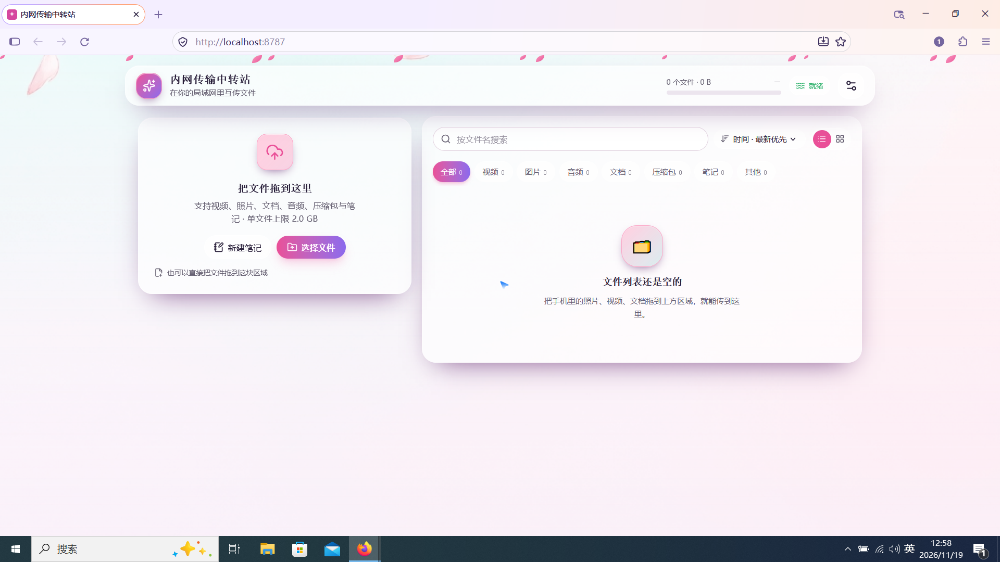

# ACG 中转站

内网文件传输中转站。一个 Node 进程，浏览器打开就能用——电脑、手机、平板在同一个 WiFi 下，互相拖文件进去、拖出来，不需要装 App，也不依赖任何云服务。



## 功能

- **分片上传**：8MB 一片，2GB 大文件也不会卡死浏览器，支持暂停 / 继续 / 取消
- **断点续传**：刷新页面、断网重连，已传的分片不丢
- **视频 / 音频边下边播**：HTTP Range 支持，拖进度条不用等整个文件下完
- **笔记**：直接在网页里写 Markdown，当作简易剪贴板
- **重命名 / 缩略图**：视频自动抽帧生成封面
- **自动列出局域网地址**：启动后终端会把 `http://192.168.x.x:8787` 打印出来，手机直接访问
- **零依赖后端**：`server/index.mjs` 只用 Node 内置模块，不需要 `npm install`

## 电脑版运行

需要 Node.js 18+（推荐 22 LTS）。

```bash
# 1. 装前端依赖并构建
pnpm install
pnpm build

# 2. 启动服务（默认 8787 端口）
node server/index.mjs

# 自定义端口 / 数据目录
PORT=9000 ACG_DATA=/path/to/data node server/index.mjs
```

浏览器打开终端里打印的局域网地址即可。

## 手机版（Termux）

旧安卓手机废物利用，装 Termux 就能当文件服务器。

1. 在 Termux 里装 Node：
   ```bash
   pkg update && pkg install nodejs-lts -y
   termux-wake-lock
   ```
2. 从 [Releases](../../releases) 下载 `acg-termux.tar.gz`，传到手机：
   ```bash
   mkdir -p ~/acg && tar xzf acg-termux.tar.gz -C ~/acg
   ```
3. 启动：
   ```bash
   bash ~/acg/acg-termux/start.sh
   ```
4. 同一 WiFi 下的电脑访问 `http://<手机IP>:8787`。

> 手机端包是已经构建好的 `dist/` + `server/index.mjs`，**不需要**在手机上跑 `pnpm install`。
>
> 详细说明（开机自启、故障排查、共享存储路径）见包里的 `README.txt`。

## 安全提醒

这个服务**没有任何登录鉴权**，只在可信内网里开。要暴露到公网，自己前面加一层反代 + 口令。

## 技术栈

- 前端：React 19 + Vite 7 + TanStack Router + Tailwind v4 + Radix UI
- 后端：Node 原生 `http`，文件落盘到 `data/files/`，元信息存 `data/index.json`
- 单文件上限：默认 2GB（`ACG_MAX_BYTES` 可调）

## 协议

[PolyForm Noncommercial 1.0.0](./LICENSE) —— 个人学习、研究、非商业使用免费，禁止商用。
